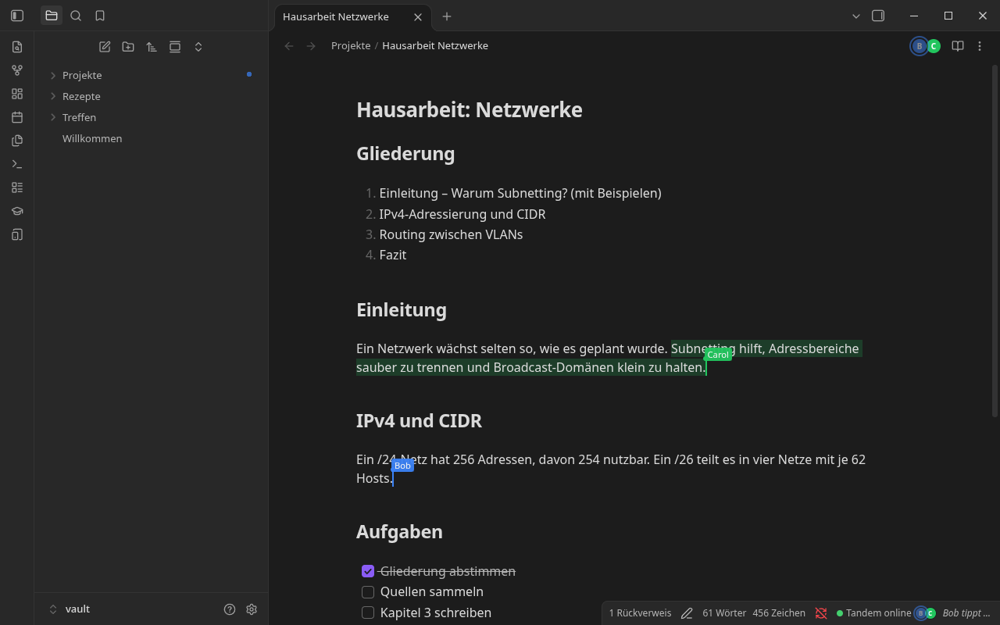
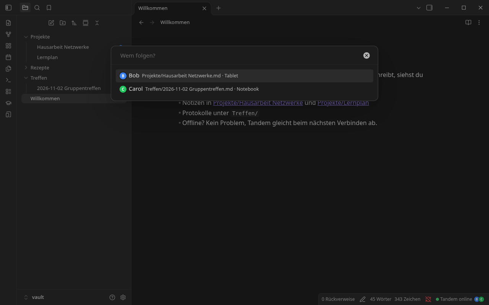
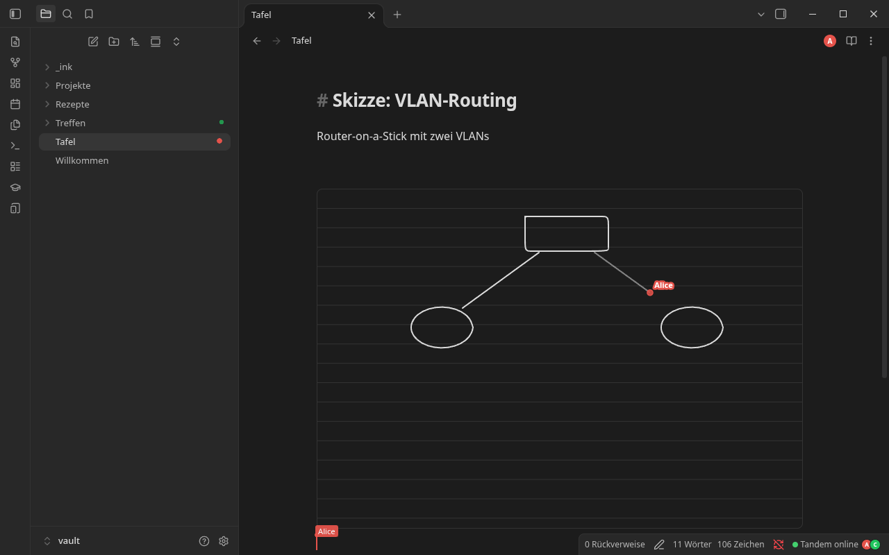
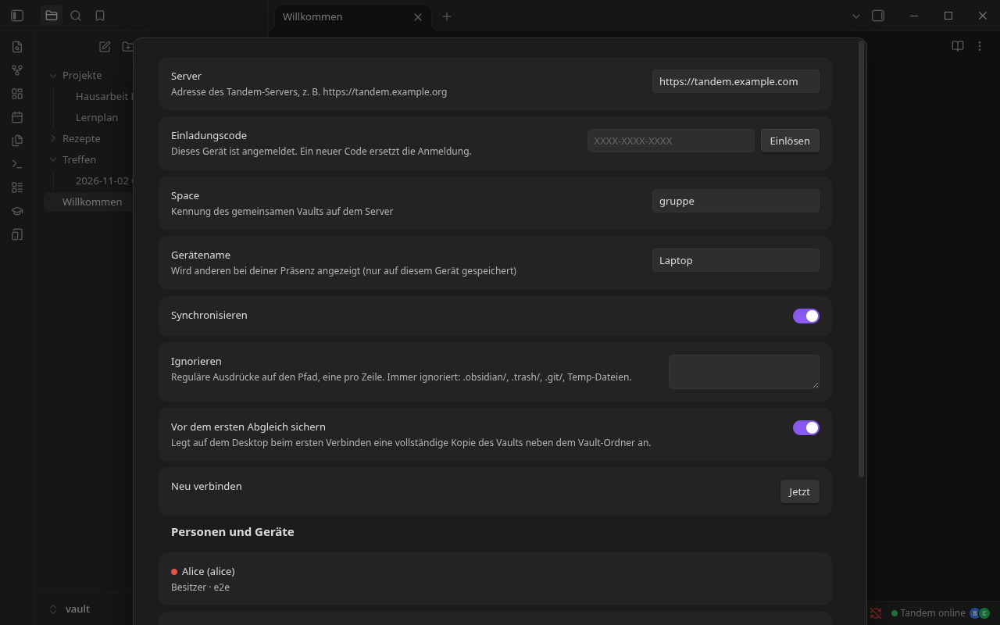
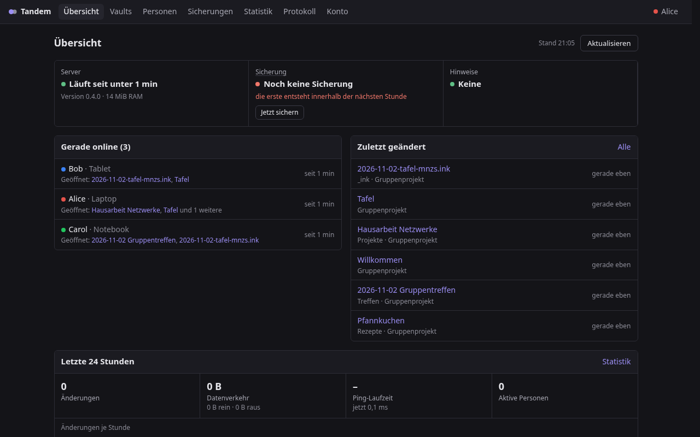
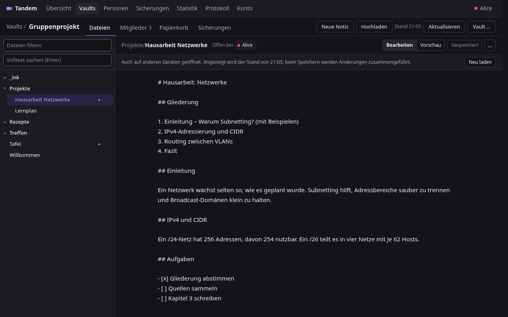
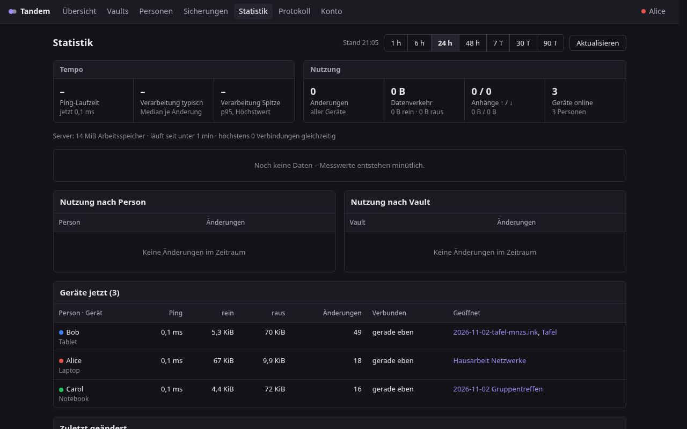
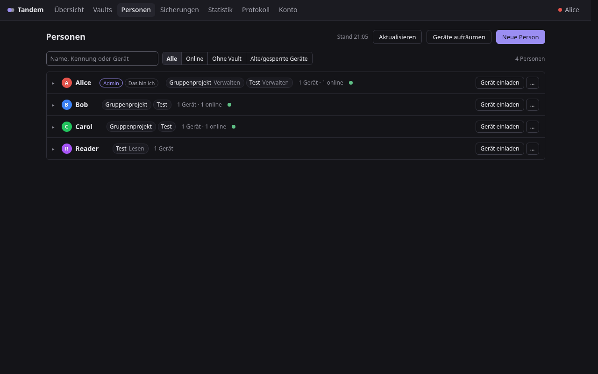
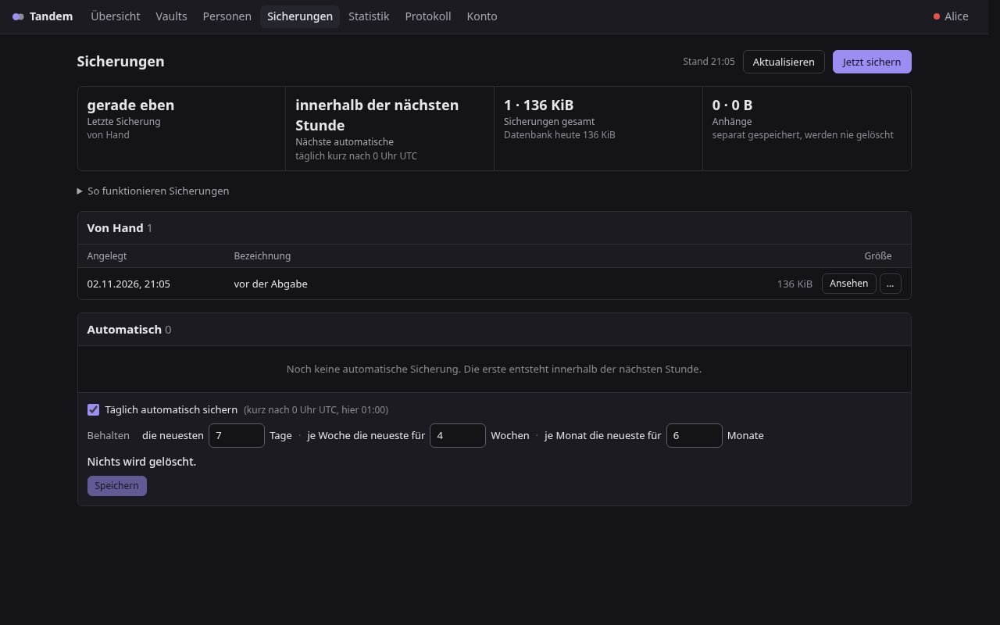

<h1 align="center">Tandem</h1>

<p align="center">
  <b>Echtzeit-Zusammenarbeit und Vault-Sync für Obsidian, selbst gehostet.</b><br>
  Live-Cursor wie in Google Docs, Sync des ganzen Vaults, ein winziger Rust-Server statt CouchDB.
</p>

<p align="center">
  <a href="https://github.com/Gamecat-HD/obsidian-tandem/releases/latest"></a>
  
  
  
</p>

<p align="center">
  
</p>

---

## Warum Tandem?

Self-hosted LiveSync synchronisiert Dateien über CouchDB. Das funktioniert, aber man sieht nicht, wer gerade wo schreibt. Gleichzeitige Änderungen werden erst nachträglich zusammengeführt, und die CouchDB braucht viel Speicher. Tandem setzt stattdessen auf **CRDTs (Yjs)**:

- **Gemeinsam schreiben:** Änderungen werden Zeichen für Zeichen zusammengeführt, ohne Konflikte. Jeder sieht Cursor, Markierung und Namensschild der anderen.
- **Ganzer Vault:** Notizen, Ordner, Umbenennungen und Anhänge auf allen Geräten, auch offline.
- **Schlank:** ein statischer Binary mit SQLite, in Produktion **~6 MiB RAM** (vorher ~5,6 GB für die CouchDB).
- **Komplett selbst gehostet:** kein fremdes Konto, kein Cloud-Dienst, keine Telemetrie.

## Funktionen

| | |
|---|---|
| ✍️ **Live-Tippen** | Cursor mit Namensschild, Markierungen, „X tippt …“, Undo nur für eigene Änderungen |
| 👀 **Präsenz** | Avatare, Punkte im Dateibaum, **Folgen** (springt und scrollt mit) |
| 🗂️ **Vault-Sync** | alle Dateien, offline-fähig, 3-Wege-Merge bei Änderungen von außen (git, Skripte, KI-Werkzeuge) |
| 📎 **Anhänge** | nach Hash dedupliziert, gestreamt (auch PDFs mit über 50 MB), Konfliktkopien statt Datenverlust |
| 🖊️ **[Ink Blocks](https://github.com/Gamecat-HD/obsidian-ink-blocks)** | Handschrift-Striche erscheinen **live während des Schreibens** beim anderen |
| 📊 **[Zellwerk](https://github.com/Gamecat-HD/obsidian-zellwerk)** | Excel-Tabellen (`.xlsx`) **live gemeinsam** bearbeiten: Zellcursor, gleichzeitiges Einfügen von Zeilen, keine Konfliktkopien ([Live-API](docs/LIVE-API.md)) |
| 📱 **Mobil** | Android und iPad/iPhone. Trennt im Hintergrund, um Akku zu sparen |
| 🔎 **Blame** | Wie `git blame`: pro Zeile, wer sie zuletzt geändert hat und wann (Befehl „Blame ein/aus“) |
| 🕓 **Verlauf & Sicherungen** | Versionsgeschichte je Notiz, tägliche Server-Sicherung, Vault-Kopie vor dem ersten Abgleich |
| 🔐 **Rechte** | Besitzer / Schreiben / Nur-Lesen, Einladungscodes, einzeln sperrbare Geräte |
| 🔒 **Ende-zu-Ende-verschlüsselt** (pro Vault) | Notizen, Dateinamen, Anhänge und Cursor verlassen die Geräte nur verschlüsselt, der Server sieht nur Chiffretext. [Details](docs/E2EE.md) |
| 🛠️ **Admin-Oberfläche** | Vaults durchsuchen und bearbeiten, Personen, Geräte, Sicherungen, Statistik. Passwort + Code oder Passkey |
| ⬆️ **Updates** | Knopf in den Einstellungen: lädt die neueste Version aus den GitHub-Releases (mit Prüfsummen) |

## Screenshots

<table>
  <tr>
    <td width="50%"><br><sub><b>Präsenz:</b> Wer ist wo? Ein Klick, und du folgst.</sub></td>
    <td width="50%"><br><sub><b>Ink Blocks live:</b> Alices Strich ist bei Bob schon während des Zeichnens zu sehen.</sub></td>
  </tr>
  <tr>
    <td width="50%"><br><sub><b>Einrichten:</b> Server-Adresse und Einladungscode, fertig.</sub></td>
    <td width="50%"><br><sub><b>Admin:</b> Übersicht, wer online ist und was sich geändert hat.</sub></td>
  </tr>
  <tr>
    <td width="50%"><br><sub><b>Vault-Browser:</b> Notizen im Browser bearbeiten. Die Änderung kommt live in Obsidian an.</sub></td>
    <td width="50%"><br><sub><b>Statistik:</b> Latenz, Datenverkehr und Änderungen je Gerät.</sub></td>
  </tr>
  <tr>
    <td width="50%"><br><sub><b>Personen:</b> Einladen, Rollen, Geräte sperren.</sub></td>
    <td width="50%"><br><sub><b>Sicherungen:</b> täglich und von Hand, durchsuchen und wiederherstellen.</sub></td>
  </tr>
</table>

<sub>Alle Bilder entstehen automatisch mit <code>node e2e/screenshots.mjs</code> aus echten Obsidian-Instanzen und einem Demo-Vault.</sub>

## Schnellstart

**Server** (Docker, Details in der [Installationsanleitung](docs/INSTALL.md)):

```bash
VER=0.4.0
mkdir -p tandem/data && cd tandem
curl -L -o tandem-server https://github.com/Gamecat-HD/obsidian-tandem/releases/download/$VER/tandem-server-$VER-x86_64-linux-musl
curl -L -o Dockerfile https://raw.githubusercontent.com/Gamecat-HD/obsidian-tandem/$VER/deploy/Dockerfile.prebuilt
chmod +x tandem-server && docker build -t tandem-server:latest .
docker run -d --name tandem --restart unless-stopped -p 127.0.0.1:8095:8080 -v tandem-data:/data \
  -e TANDEM_PUBLIC_URL=https://tandem.example.com tandem-server:latest
docker exec tandem /tandem-server setup notizen anna "Anna"     # → Einladungscode
```

Davor einen Reverse-Proxy mit **HTTPS und WebSockets** setzen (Caddy: `reverse_proxy 127.0.0.1:8095`).

**Obsidian:** `tandem-<version>.zip` aus dem [Release](https://github.com/Gamecat-HD/obsidian-tandem/releases/latest) nach `<Vault>/.obsidian/plugins/tandem/` entpacken (oder per [BRAT](https://github.com/TfTHacker/obsidian42-brat): `Gamecat-HD/obsidian-tandem`), aktivieren, unter Einstellungen → Tandem Server-Adresse und Einladungscode eintragen.

📖 **[Vollständige Installationsanleitung](docs/INSTALL.md)** · 🔁 [Umstieg von LiveSync](docs/UMSTIEG.md) · 🛠️ [Admin-Oberfläche](docs/ADMIN.md)

## Leistung

| | |
|---|---|
| Tastendruck A → Editor von B, lokal | **3,6 ms** Median |
| Tastendruck bei 80 ms Netz-Rundlaufzeit | **84 ms** (≈ 4 ms über der Netzlaufzeit) |
| Erstabgleich neues Gerät, 1026 Dateien (lokal) | **1,8 s** |
| Server-RAM in Produktion (~4600 Dateien, 560 MB) | **5,9 MiB** |
| Server-RAM, 100 Clients × 200 Notizen unter Dauerlast | 47,7 MiB Spitze, alle 20 000 Kopien identisch |
| Docker-Image / Plugin | 11,5 MiB / 49 KB gzip |

Messaufbau, alle Werte und wie man sie selbst nachmisst: **[docs/PERFORMANCE.md](docs/PERFORMANCE.md)**

## Wie es funktioniert

```
 Obsidian (Desktop / Mobil)                         tandem-server (Rust)
┌──────────────────────────────┐                  ┌──────────────────────────────┐
│ Tandem-Plugin                │   1 WebSocket    │ axum + yrs (Yjs in Rust)     │
│  • Y.Doc pro offener Notiz   │◀───────────────▶│  • Docs laden/entladen        │
│  • y-codemirror.next (CM6)   │  y-sync +        │  • SQLite: Updates, Snapshots│
│  • Vault-Index (Pfad → Doc)  │  Awareness,      │  • Anhänge nach SHA-256      │
│  • Offline-Cache (IndexedDB) │  gemultiplext    │  • Rechte, Tokens, Admin-UI  │
│  • Ink-Blocks-Brücke         │                  │  • tägliche Sicherungen      │
└──────────────────────────────┘                  └──────────────────────────────┘
```

Jede Notiz ist ein eigenes Yjs-Dokument, der Dateibaum ein weiteres. Änderungen von außen (z. B. `git pull`) erkennt das Plugin per Diff und spielt sie als CRDT-Update ein. Hintergründe: [Plan](docs/PLAN.md), [Protokoll](docs/PROTOKOLL.md), [Architekturentscheidungen](docs/adr/).

## Entwickeln

```bash
cd plugin && npm ci && npm run build && npm test      # Plugin (TypeScript, esbuild, vitest)
cd server && cargo test && ./build-static.sh           # Server (statischer musl-Binary)
TANDEM_SERVER=rust node e2e/run.mjs                    # E2E: echte Obsidian-Instanzen (headless) + Server
node e2e/bench.mjs 0                                   # Latenz-Benchmark
node protocol/loadtest.mjs 20 50 30                    # Lasttest mit RAM-Messung
node e2e/screenshots.mjs                               # README-Bilder neu erzeugen
```

Die E2E-Tests starten isolierte, headless Obsidian-Instanzen (eigenes Profil, Wegwerf-Vault) und steuern sie über das Chrome DevTools Protocol. Die eigene Obsidian-Installation bleibt unberührt.

| Ordner | Inhalt |
|---|---|
| `plugin/` | Obsidian-Plugin (TypeScript, Yjs, y-codemirror.next) |
| `server/` | `tandem-server` (Rust, yrs, axum, SQLite), `server/admin-ui/` = Admin-Oberfläche |
| `protocol/` | Drahtformat, Testvektoren, Referenz-Server, Lasttest |
| `deploy/` | Dockerfiles, Compose-Vorlage, Deploy-Skripte (Portainer-API) |
| `e2e/` | Tests, Benchmark und Screenshots mit echten Obsidian-Instanzen |
| `docs/` | Installation, Leistung, Admin, Protokoll, ADRs |

## Status

Tandem ist im täglichen Einsatz (mehrere Personen, Desktop und Tablet) und ersetzt dort LiveSync. Das Plugin ist noch nicht im offiziellen Community-Katalog. Ende-zu-Ende-Verschlüsselung gibt es pro Vault ([E2EE.md](docs/E2EE.md)). In Klartext-Vaults sieht der Server die Inhalte, deshalb gehört er auf eigene Hardware.
