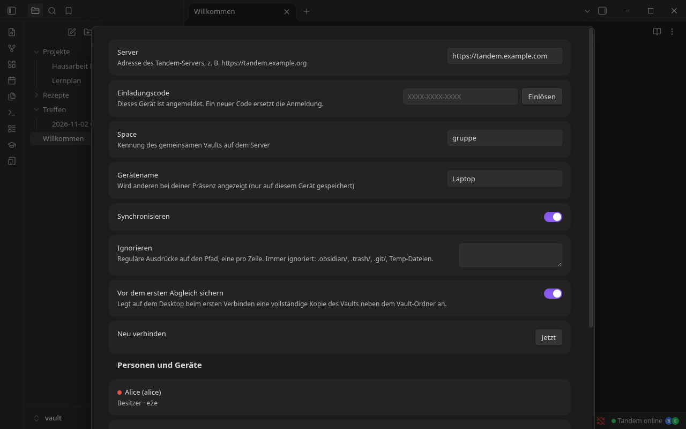
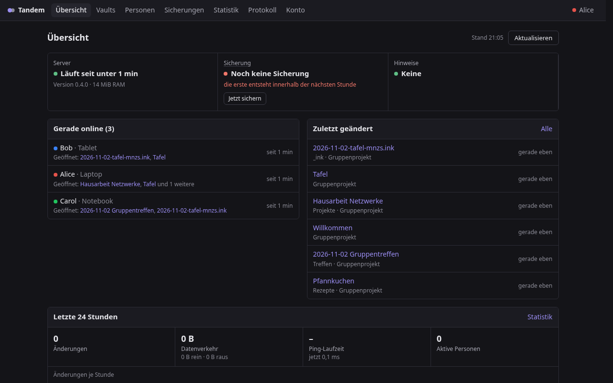

# Installation

Tandem besteht aus zwei Teilen:

1. **`tandem-server`**: ein einzelner, statisch gelinkter Binary (Rust, SQLite eingebaut). Läuft am einfachsten als Docker-Container hinter einem Reverse-Proxy mit HTTPS.
2. **Obsidian-Plugin „Tandem“** auf jedem Gerät (Windows, macOS, Linux, Android, iPad/iPhone).

Zeitaufwand: etwa 15 Minuten, wenn Docker und ein Reverse-Proxy schon laufen.

> **Wichtig:** Tandem und Self-hosted LiveSync dürfen **nie gleichzeitig** denselben Vault synchronisieren. Tandem erkennt ein aktives LiveSync und startet dann nicht. Für den Umstieg siehe [UMSTIEG.md](UMSTIEG.md).

---

## 1. Server

### Voraussetzungen

- Linux-Server mit Docker (x86_64). Der Server braucht im Betrieb nur etwa 6–50 MiB RAM.
- Eine (Sub-)Domain, z. B. `tandem.example.com`, mit einem Reverse-Proxy davor, der **HTTPS und WebSockets** kann (Caddy, Nginx, Nginx Proxy Manager, Traefik …).

### 1.1 Image bauen

**Variante A: aus dem Release (empfohlen, nichts wird kompiliert)**

```bash
mkdir -p tandem-image/data && cd tandem-image
VER=0.4.0
curl -LO https://github.com/Gamecat-HD/obsidian-tandem/releases/download/$VER/tandem-server-$VER-x86_64-linux-musl
curl -LO https://github.com/Gamecat-HD/obsidian-tandem/releases/download/$VER/SHA256SUMS
sha256sum --check --ignore-missing SHA256SUMS
mv tandem-server-$VER-x86_64-linux-musl tandem-server && chmod +x tandem-server
curl -L -o Dockerfile https://raw.githubusercontent.com/Gamecat-HD/obsidian-tandem/$VER/deploy/Dockerfile.prebuilt
docker build -t tandem-server:latest .
```

**Variante B: aus dem Quellcode im Container bauen** (keine lokale Rust-Toolchain nötig, braucht beim Bauen aber 1–2 GB RAM)

```bash
git clone https://github.com/Gamecat-HD/obsidian-tandem.git
cd obsidian-tandem/server
docker build -f ../deploy/Dockerfile -t tandem-server:latest .
```

Das Image ist `FROM scratch` (≈ 11 MiB): keine Shell, unprivilegierter Nutzer `10001`, Healthcheck eingebaut.

### 1.2 Container starten

[`deploy/docker-compose.yml`](../deploy/docker-compose.yml) ist die Vorlage. Sie ist schreibgeschützt, ohne Capabilities und hat ein Speicherlimit von 128 MiB:

```yaml
services:
  tandem:
    image: tandem-server:latest
    pull_policy: never
    container_name: tandem
    restart: unless-stopped
    environment:
      TANDEM_PUBLIC_URL: https://tandem.example.com   # für Links der Admin-Oberfläche
    volumes:
      - tandem-data:/data
    ports:
      - "127.0.0.1:8095:8080"     # nur lokal, öffentlich nur über den Reverse-Proxy
    mem_limit: 128m
    pids_limit: 64
    read_only: true
    security_opt: [no-new-privileges:true]
    cap_drop: [ALL]
volumes:
  tandem-data:
```

```bash
docker compose up -d
curl http://127.0.0.1:8095/health      # → ok
```

Liegt dein Reverse-Proxy selbst in Docker, hänge den Container in dessen Netzwerk (in der Vorlage `networks: proxy`, Variable `PROXY_NETWORK`) und leite auf `tandem:8080` weiter.

| Umgebungsvariable | Standard | Bedeutung |
|---|---|---|
| `TANDEM_DATA` | `/data` | Datenbank (`tandem.db`), Anhänge (`blobs/`), Sicherungen (`backups/`) |
| `TANDEM_LISTEN` | `0.0.0.0:8080` | Adresse im Container |
| `TANDEM_PUBLIC_URL` | – | öffentliche Adresse, nur für die Einrichtungslinks der Admin-Oberfläche |
| `TANDEM_ADMIN` | an | `off` schaltet `/admin/` komplett ab |
| `RUST_LOG` | `tandem_server=info` | Log-Detailgrad |

### 1.3 Reverse-Proxy mit HTTPS

Beispiel **Caddy** (holt das Zertifikat selbst):

```caddy
tandem.example.com {
    reverse_proxy 127.0.0.1:8095
}
```

Beispiel **Nginx**:

```nginx
server {
    listen 443 ssl http2;
    server_name tandem.example.com;
    # ssl_certificate …; ssl_certificate_key …;
    client_max_body_size 0;                 # große Anhänge
    location / {
        proxy_pass http://127.0.0.1:8095;
        proxy_http_version 1.1;
        proxy_set_header Upgrade $http_upgrade;
        proxy_set_header Connection "upgrade";
        proxy_set_header Host $host;
        proxy_set_header X-Real-IP $remote_addr;
        proxy_set_header X-Forwarded-Proto $scheme;
        proxy_read_timeout 1h;
    }
}
```

**Nginx Proxy Manager:** Proxy-Host anlegen, Forward `tandem` : `8080`, **Websockets Support an**, SSL mit Let's Encrypt, Force SSL.

**Cloudflare (Proxy an)** funktioniert, auch mit WebSockets. Client und Server pingen alle 25–30 s, damit Cloudflare ruhende Verbindungen nicht nach 100 s trennt. SSL-Modus „Full (strict)“.

> **Sicherheit:** Der Server wertet `CF-Connecting-IP` / `X-Real-IP` für die Bremsen bei Fehlversuchen aus. Wenn Cloudflare davor sitzt, sollte der Ursprungsserver auf Port 80/443 **nur Cloudflare-Adressen** annehmen (Firewall). Sonst kann man Cloudflare umgehen und diese Header fälschen.

Prüfen: `curl https://tandem.example.com/health` → `ok`

### 1.4 Ersten Vault (Space) und Besitzer anlegen

```bash
docker exec tandem /tandem-server setup notizen anna "Anna"
#   Space „notizen“, Besitzerin „anna“ mit Anzeigename „Anna“
#   → gibt einen Einladungscode aus, z. B. 7KQX-M2PA-ZR4D (72 h gültig, einmal einlösbar)
```

Ohne Docker heißt der Befehl genauso: `tandem-server --data ./data setup notizen anna "Anna"`.

---

## 2. Plugin in Obsidian

Das Plugin ist (noch) nicht im offiziellen Community-Katalog.

**Variante A: manuell**

1. `tandem-<version>.zip` aus dem [neuesten Release](https://github.com/Gamecat-HD/obsidian-tandem/releases/latest) laden.
2. Entpacken nach `<Vault>/.obsidian/plugins/tandem/`. Darin liegen dann `main.js`, `manifest.json` und `styles.css`.
3. Obsidian → Einstellungen → Community-Plugins → „Tandem“ aktivieren.

**Variante B: mit [BRAT](https://github.com/TfTHacker/obsidian42-brat)** (aktualisiert automatisch)

BRAT installieren → „Add beta plugin“ → `Gamecat-HD/obsidian-tandem`.

### 2.1 Anmelden



1. Einstellungen → **Tandem**
2. **Server:** `https://tandem.example.com`
3. **Einladungscode** eintragen → **Einlösen**. Das Gerät bekommt ein eigenes Token, der Space wird automatisch eingetragen.
4. **Gerätename** vergeben (z. B. „Laptop“, „Tablet“). Den sehen die anderen bei deiner Präsenz.
5. **Synchronisieren** einschalten.

Beim ersten Verbinden legt Tandem auf dem Desktop eine **vollständige Kopie des Vaults** neben dem Vault-Ordner an (`<Vault>.tandem-sicherung-<Datum>`) und gleicht dann ab. Hatten mehrere Geräte den Vault schon (z. B. von LiveSync), erkennt Tandem gleiche Dateien und fügt nichts doppelt ein.

In der Statusleiste steht danach **„Tandem online“** mit den Avataren der anderen.

### 2.2 Weitere Geräte und Personen

**Am einfachsten in Obsidian:** Einstellungen → Tandem → **Personen und Geräte**. Besitzer erzeugen dort Codes für eigene weitere Geräte und laden neue Personen ein (Kennung, Name, Rolle).

**Ein Gerät gehört zu einem Vault.** Ein zweiter Vault auf demselben Rechner braucht einen eigenen Code und steht in der Admin-Oberfläche als eigener Eintrag unter diesem Vault.

**Oder per Kommandozeile:**

```bash
docker exec tandem /tandem-server invite anna --space schule        # weiteres Gerät für Anna, gilt nur für diesen Vault
docker exec tandem /tandem-server user add ben "Ben"                 # neue Person
docker exec tandem /tandem-server space member notizen ben write     # owner | write | read
docker exec tandem /tandem-server invite ben                         # Code für Ben
docker exec tandem /tandem-server token list                         # angemeldete Geräte
docker exec tandem /tandem-server token revoke <kennung>             # Gerät sperren
```

Rollen: **owner** (alles, inkl. Einladen), **write** (lesen und schreiben), **read** (nur lesen).

---

## 3. Admin-Oberfläche (optional)



Unter `https://tandem.example.com/admin/`: alle Vaults durchsuchen und bearbeiten, Personen und Geräte verwalten, Sicherungen, Statistik, Protokoll. Anmeldung mit Passwort **und** Authenticator-App (TOTP).

```bash
docker exec tandem /tandem-server admin setup anna
# → https://tandem.example.com/admin/#setup=<code>   (30 min gültig, einmalig)
```

Den Link öffnen, Passwort festlegen, QR-Code scannen, fertig. Derselbe Befehl setzt den Zugang zurück. Details und Sicherheitsmodell: [ADMIN.md](ADMIN.md). Wer die Oberfläche nicht braucht, setzt `TANDEM_ADMIN=off`.

---

## 4. Sicherungen

- **Server:** täglich automatisch nach `/data/backups/`, mit Aufbewahrung nach Tag/Woche/Monat (einstellbar in der Admin-Oberfläche). Von Hand: `docker exec tandem /tandem-server backup /data/backups/manuell.db` (konsistent im laufenden Betrieb).
- **Export als normale Dateien** (z. B. für ein Git-Repo):
  ```bash
  docker exec tandem /tandem-server export notizen > notizen.tar
  ```
- **Versionsgeschichte** jeder Notiz: Befehl „Tandem: Versionsgeschichte dieser Datei“ in Obsidian oder im Vault-Browser der Admin-Oberfläche.
- Das **Volume `tandem-data`** enthält alles. Wer es sichert (z. B. mit restic), hat Server-Stand und tägliche Sicherungen.

## 5. Aktualisieren

```bash
# neues Image bauen (wie in 1.1), dann:
docker compose up -d --force-recreate
```

Ab 0.5.0: Einstellungen → Tandem → **Version** → „Nach Updates suchen“ bzw. „Aktualisieren“ (Befehl „Tandem: Nach Updates suchen“). Tandem lädt die drei Dateien aus dem neuesten GitHub-Release, prüft sie gegen `SHA256SUMS` und lädt sich neu. Einmal am Tag meldet es von selbst, wenn es etwas Neues gibt. Jedes Gerät aktualisiert sich selbst (`.obsidian/` wird nicht synchronisiert). Alternativ BRAT oder die drei Dateien aus dem Release von Hand in `.obsidian/plugins/tandem/` ersetzen. `data.json` dabei **nicht** überschreiben, darin stehen Server und Space.

Server und Plugin am besten gemeinsam aktualisieren (siehe [CHANGELOG](../CHANGELOG.md)).

Wer per Portainer-API deployt: [`deploy/redeploy.sh`](../deploy/redeploy.sh) baut den Binary, baut das Image auf dem Server und tauscht den Container aus. Bleibt der neue Container nicht „healthy“, kommt automatisch der alte zurück. Einstellungen in `deploy/local.env` (Vorlage: [`local.env.example`](../deploy/local.env.example)).

## 6. Fehlersuche

| Symptom | Ursache / Lösung |
|---|---|
| Hinweis „Self-hosted LiveSync ist aktiv“ | LiveSync in diesem Vault deaktivieren. Beide gleichzeitig führen zu Datenverlust. |
| Statusleiste bleibt „offline“ | `https://<host>/health` im Browser prüfen. Wenn das geht: WebSocket-Weiterleitung im Proxy fehlt (`Upgrade`/`Connection`-Header bzw. „Websockets Support“). |
| Cloudflare-Fehler 525 | Proxy-Host oder Zertifikat am Ursprungsserver fehlt. |
| „Code ungültig oder abgelaufen“ | Codes gelten 72 h und nur einmal → neuen erzeugen. |
| Große Anhänge brechen ab | Upload-Limit im Proxy (`client_max_body_size 0` bei Nginx). |
| App stürzt beim Abgleich ab (Android) | Sehr große Anhänge (ab etwa 50 MB) sprengen dort den Speicher. Tandem überspringt die Datei danach und meldet das; erneut versuchen unter Einstellungen → Tandem. |
| Container startet neu (OOM) | Server < 0.3.1 hat Anhänge im RAM gepuffert → aktualisieren. |
| Logs ansehen | `docker logs tandem` |
